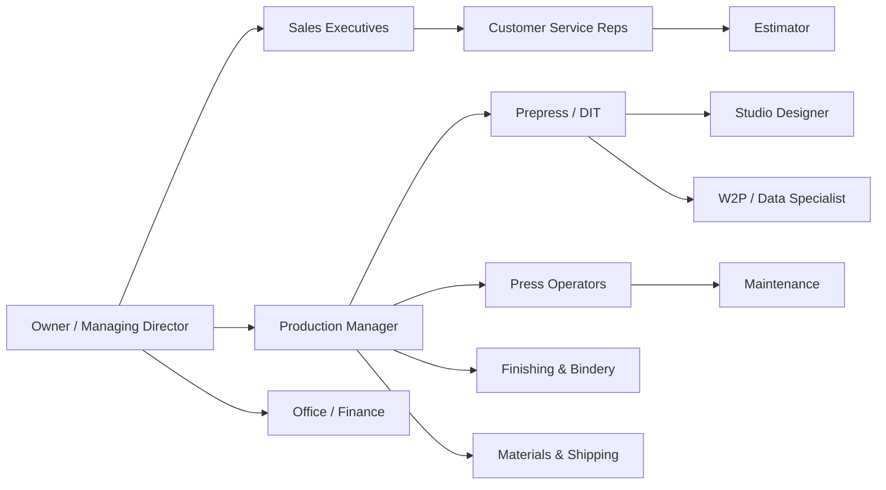

# Awesome Digital Printing 

A curated knowledge base of everything related to the **digital printing industry** — the technologies, the machines, the inks, the software, the finishing, the standards, and the *idioms* (the peculiar jargon printers use on the shop floor every day).

> "Offset is a craft. Digital is a science. Printing is both." — shop-floor proverb

---

## Contents

- [1. What is Digital Printing?](#1-what-is-digital-printing)
- [2. Print Technologies](#2-print-technologies)
  - [2.1 Toner-based](#21-toner-based)
  - [2.2 Inkjet](#22-inkjet)
  - [2.3 Dye-sublimation & specialty](#23-dye-sublimation--specialty)
- [3. Machine Categories](#3-machine-categories)
- [4. Major Machine & Vendor Landscape](#4-major-machine--vendor-landscape)
- [5. Inks](#5-inks)
- [6. Substrates & Media](#6-substrates--media)
- [7. The Team: Roles in a Small-to-Medium Print Company](#7-the-team-roles-in-a-small-to-medium-print-company)
- [8. Software & Workflow](#8-software--workflow)
- [9. Color Management & Standards](#9-color-management--standards)
- [10. Finishing & Post-Press](#10-finishing--post-press)
- [11. Variable Data & Web-to-Print](#11-variable-data--web-to-print)
- [12. Prepress 101](#12-prepress-101)
- [13. Glossary: The Idioms of the Trade](#13-glossary-the-idioms-of-the-trade)
  - [13.1 File & Artwork Jargon](#131-file--artwork-jargon)
  - [13.2 Color Jargon](#132-color-jargon)
  - [13.3 Press-Side Jargon](#133-press-side-jargon)
  - [13.4 Paper & Substrate Jargon](#134-paper--substrate-jargon)
  - [13.5 Bindery & Finishing Jargon](#135-bindery--finishing-jargon)
  - [13.6 Business & Sales Jargon](#136-business--sales-jargon)
  - [13.7 Shop-Floor Sayings & folklore](#137-shop-floor-sayings--folklore)
- [14. Associations, Expos & Institutions](#14-associations-expos--institutions)
- [15. Publications, Communities & Learning](#15-publications-communities--learning)
- [16. Sustainability](#16-sustainability)
- [17. Trends & The Future](#17-trends--the-future)
- [18. Contributing](#18-contributing)

---

## 1. What is Digital Printing?

**Digital printing** means printing *directly from a digital file* — no plates, no film, no fixed image carrier (or, where one exists, one that is re-imaged on the fly for every page).

The contrast that defines the whole industry:

| | **Offset / Analog** | **Digital** |
|---|---|---|
| Image carrier | Physical plate per page | None (or dynamic drum) |
| Setup cost ("makeready") | High, per job | Essentially zero |
| Cost per unit at quantity | Very low | Flat, never improves with volume |
| Variable data | Practically impossible | Native — every page can differ |
| Run lengths | Long runs (10k–millions) | Short runs, print-on-demand (1–1,000) |
| Turnaround | Days | Hours |

The economics in one sentence: **digital's unit cost is flat, offset's unit cost falls with volume — so there is always a crossover point in run length.** Everything the industry argues about lives near that crossover.

The three questions every print buyer asks:
1. **What is it printed on?** (substrate)
2. **How does the ink stick?** (ink/toner chemistry + curing)
3. **How fast can you have it?** (workflow and finishing)

---

## 2. Print Technologies

### 2.1 Toner-based

Electrophotography — a charged photoconductor drum, laser (or LED) exposure, charged toner powder, heat fusion.

- **Laser printing / LED printing** — office workhorses through production monsters.
  - **Xerox iGen / Versant** — the high end of sheet-fed toner color.
  - **Kodak (Nexpress heritage)** and **Ricoh Pro** series production presses.
  - **HP Indigo** — a hybrid: uses *ElectroInk* liquid toner on a blanket; offset-like quality, huge media and special-ink flexibility (white, fluorescent, metallic — one of the very few digital presses running true PANTONE®-guided ink libraries).
- **LED vs laser** — LED arrays have no moving parts, so less to maintain; output quality is now equivalent at production speeds.
- **Strengths**: crisp small text, cheap mono, handles offset-style coated stocks, native duplexing.
- **Weaknesses**: gloss banding on heavy coverage, fuser heat limits media, fewer wide-format options.

### 2.2 Inkjet

The center of gravity of the whole industry today. Droplets of ink ejected from nozzles, typically 2–70 picoliters, onto media.

Two fundamental families:

- **Continuous Inkjet (CIJ)** — a constant stream broken into droplets by charge and deflection. Barely touches graphics; dominates **coding & marking** (date codes, batch numbers on food, pharma, beverage). Vendors: Videojet, Domino, Markem-Imaje, Hitachi, Linx.
- **Drop-on-Demand (DOD)** — fires a droplet only when a pixel demands one. Subdivided by firing mechanism:
  - **Thermal (bubble jet)** — heater boils the ink into an expanding bubble. Inventors of office inkjet (HP, Canon). Cheap heads, but limited to water-compatible inks and shorter head life.
  - **Piezoelectric** — a piezo crystal flexes and squeezes/pushes the droplet out. The industrial workhorse: nearly any ink chemistry, outstanding reliability. Head names to know: **Epson PrecisionCore**, **Kyocera**, **Ricoh**, **Fujifilm Dimatix (StarFire, Sapphire)**, **Konica Minolta**, **Xaar**, **SII Printek**, **Toshiba Tec**, **Memjet** (page-wide thermal arrays).
  - **Grayscale vs binary** — modern heads vary droplet size in flight (grayscale/inertial), giving smooth highlights from only a few ink colors.

Machine shapes inkjet takes:

  - **Wide format (roll-fed, 44"–126")** — signage, banners, vehicle wraps, soft signage (textile).
  - **Grand format (flatbed / hybrid, 1.5–5 m)** — rigid boards, glass, wood, corrugated, foam PVC, direct-to-object.
  - **Production sheet-fed** — presses built like offset but with inkjet bars: **HP PageWide Industrial**, **Kodak Prosper**, **Ricoh InfoPrint/Pro VC**, **Canon ProStream / ColorStream**, **Screen Truepress Jet**.
  - **Label & packaging** — digital label presses (pressure-sensitive film, shrink sleeves) — **HP Indigo 20000/25K**, **Epson SurePress**, integrated with converting lines (**CERM**, **ABG**).
  - **Industrial / functional** — high-speed single-pass inkjet for textiles (**MS** and **Reggiani** lines, later bought into the **Koenig & Bauer / Durst** orbits), ceramics, corrugated (single-pass box printing), printed electronics, and decorative direct-to-object work.
  - **Single-pass vs scanning** — single-pass bars cover the full width and print as media moves by once (fast, huge head arrays, fortune in heads); scanning machines sweep a carriage back and forth (slower, cheaper, still the wide-format default).

### 2.3 Dye-sublimation & specialty

- **Dye-sublimation (dye-sub)** — sublimation ink printed (directly or via transfer paper), baked at ~190–210 °C so the dye turns to gas and bonds into polyester. Powers sportswear, soft signage, phone cases, mugs (with mug presses).
- **Solvent/eco-solvent inkjet** — the vehicle-wrap and outdoor-banner workhorse; aggressive but flexible and weatherproof.
- **UV-curable inkjet** — ink cures instantly under LED/mercury UV lamps; prints on *almost anything* rigid or roll. **UVgel** (Canon/Océ Colorado) is a gel-acrylate variant for smooth, scratch-resistant roll media.
- **Latex inkjet (HP Latex)** — water-based ink with latex polymers heat-cured for durability; near-odorless, poster/film and décor friendly.
- **Direct-to-film (DTF)** — ink on PET film + adhesive powder + heat press; ate garment decoration's lunch after ~2020.
- **Direct-to-Garment (DTG)** — water-based inkjet directly on cotton tees (Kornit, Brother GTX, Epson F-series).
- **Direct-to-shape / direct-to-object** — cylindrical and rotational inkjet onto bottles, cans, cups.
- **Analog cousins often co-located in digital shops** — screen printing (still king for opaque, low-volume-yet-cheap runs), pad/tampo printing, hot foil, and **flexography** in its digital-assisted form (now increasingly displaced at short runs by inkjet corrugated and digital labels).

---

## 3. Machine Categories

A shop-floor taxonomy — most shops are classified by what sits on their floor:

| Category | What it runs | Typical tech |
|---|---|---|
| **Copy / quick-print shop** | Brochures, business cards, short booklets | Desktop laser handled commercially, small cutters |
| **Digital commercial printer** | Marketing collateral, books, short runs | HP Indigo, Xerox iGen/Versant, Ricoh Pro, Konica Minolta AccurioPress |
| **Wide-format shop** | Posters, banners, signage, retail graphics, wraps | Roland, Mimaki, HP Latex, Epson SureColor |
| **Grand-format / flatbed shop** | Building wraps, exhibition graphics, POP displays | swissQprint, EFI VUTEk, Durst, Océ Colorado/ Arizona |
| **Soft-signage / textile shop** | Fabric banners, apparel, home textiles | Dye-sub roll-to-roll + calender |
| **Label converter** | Pressure-sensitive labels, shrink sleeves | Digital label presses + die-cutters |
| **Packaging converter** | Cartons, folding boxes, flexible film | Digital folding-carton presses |
| **Book / POD printer** | One-off books, thesis, backlist | Toner b/w + color cover press; inkjet web for mail |
| **Industrial printer** | Decorative laminate, glass, ceramics, electronics | Single-pass UV / ceramic inkjet |
| **In-house / CRD** | Corporate & education print rooms | Light production toner presses |
| **Mail / transactional printer** | Bills, statements, direct mail | Color inkjet webs + inserting |

Machine anatomy (the parts every inkjet printer shares): **printheads** (the true consumable), **ink delivery system** (reservoirs, circulation, degassing), **curing/drying** (IR, hot air, UV LED roller, calender), **media transport** (vacuum belts, clamps, grippers, transport rollers), **media handling** (roll unwind/rewind, flatbed vacuum table, hybrid feeder), **maintenance systems** (purge, wipe, capping, spit).

---

## 4. Major Machine & Vendor Landscape

*(Links to principal websites; a snapshot of the competitive landscape.)*

### Production toner (sheet-fed)
- **Xerox** (Versant; the iGen heritage) — the production-color toner benchmark for decades *(the iGen line now ships under **Fujifilm Business Innovation**, after the old Fuji Xerox split)*
- **HP Indigo** — the color + specialty ink gold standard in digital
- **Ricoh** (Pro C series)
- **Konica Minolta** (AccurioPress / AccurioLabel, plus the old bizhub PRO lineage)
- **Canon** imagePRESS (absorbed **Océ** into "Canon Production Printing" — Arizona flatbeds, Colorado, ProStream webs)
- **Kodak** (Nexpress heritage, and the Prosper inkjet webs)
- **Sindoh**, **RISO** (the "digital duplicator" — high-volume, cheap mono, still fills schools and churches)

### Wide & grand format

*The Western/Japanese incumbents:*
- **HP Latex** (the water-based volume king)
- **Roland DG** (VersaUV and resin-solvent machines — the sign-shop stalwart for decades)
- **Mimaki** (the Japanese value machines: solvent, UV, textile, 3D, and object printers)
- **Mutoh** (the other Japanese solvent/eco-solvent veteran — roll-to-roll sign & production workhorse)
- **Epson** (SureColor — aqueous poster/proof/film to textile/UV)
- **EFI** (VUTEk grand-format; and EFI Pro/Reggiani industrial, after acquiring Reggiani)
- **Durst** (Italian grand-format and textile industrial)
- **swissQprint** (premium flatbeds; NEBULA, KARIBU)
- **Canon/Océ Arizona** (the classic UV flatbed), **Colorado** (UVgel roll)
- **Fujifilm** (Acuity flatbed/hybrid presses, plus the ex-DuPont ink range)
- **Inca Digital** (UK — the flatbed pioneer of digital graphics)
- **AGFA** (Anapurna; and the Jeti line)
- **DGI / Dilli** (Korean roll-to-roll and flatbed veterans, strong in Asia's sign market)

*The Chinese machine ecosystem (a market in its own right):*
- **Gongzheng**, **Flora**, **TeckWin**, **Wit-Color**, **ThunderJet**, **Oric** — wide-range roll-to-roll solvent/UV and increasingly flatbed/hybrid machines
- Built-to-order flexibility: any width, any head set (mostly **Epson**, **Kyocera**, **Ricoh** heads) — the volume price floor of the global market, and the supply source of the DTF machine flood
- **Golden Laser** (fabric laser cutting lines, common companion for printed textile)
- Take-away: a large share of Western brand machines integrate Chinese-built components and vice versa; knowing who actually builds what is shop-floor knowledge

### Labels, packaging, industrial
- **HP Indigo 20000 / 25K** labels & flexible packaging
- **Xeikon** (toner labels & packaging — the original digital label pioneer, once part of Punch Graphix)
- **Epson SurePress** digital label press
- **Screen** Truepress Jet L350UV (labels) and 520 (folding carton)
- **Domino** (K-series inkjet presses for labels & cartons — leveraging its coding & marking head heritage)
- **Durst Tau** (labels) & **Rho** (packaging)
- **Colordyne** (US inkjet label printers/retrofit heads for flexo lines)
- **Koenig & Bauer** (RotaJET webs, and inkjet corrugation via partnership deals)
- **BOBST** (digital corrugated / label presses) — "analog converting king that went digital"

### Textile & garment decoration
- **Kornit** (the DTG/DTF production-line benchmark — direct-to-garment and apparel decoration systems)
- **Brother** (GTX DTG line), **Epson** (SureColor F-series — DTG and dye-sub)
- **MS Printing Solutions** (roll-to-roll textile inkjet, ex-La Meccanica group) plus **Reggiani** (now EFI) at industrial speeds
- **Mimaki** and **Durst** in textile roll-to-roll; **HP Stitch** (dye-sub textile printers) as the water-based alternative
- **The DTF wave**: a category essentially owned by Chinese machine builders (built on Epson heads) — cheap, everywhere, transformational for garment decorators; presses of ~60 cm with powder-shaker units can be had for a fraction of a DTG system's cost

### Coding & marking (the invisible quanta of packaging)
- **Domino**, **Videojet**, **Markem-Imaje**, **Hitachi**, **Linx**, **Macsa** (laser), **Cab** (thermal transfer overprint)

### Software vendors
- **RIP engines (the kernels)**: **Adobe PDF Print Engine (APPE)** and **Global Graphics' Harlequin** — most modern DFEs and production RIPs are built on one of these two.
- **Fiery (EFI)** — the dominant DFE for toner presses (Xerox, Canon, Ricoh, Konica Minolta, and more)
- **Caldera** (grand-format RIP), **ONYX** (wide-format RIP), **SAi** (Flexi; the entry sign-shop RIP), **VersaWorks** (Roland's own), **RasterLink** (Mimaki's own), **ErgoSoft** (textile), **ColorGate**, **CGS ORIS** (proofing), plus **ACRORIP**-class simple RIPs that power the hobby/DTF world
- **Golden Rules of RIP-land**: one RIP to one printer; every printer talks a slightly different color science.

### MIS / ERP for printers
- **EFI** (PrintSmith, Pace, Avanti, PrintFlow); **Tharstern**; **CERM** (label converters' domain standard); plus many regional and vertical-niche MIS vendors.
- Estimating + job tickets + scheduling + web-shop + invoicing + shipping: the "OS" of a print plant.

### Consumables
- **Inks**: Nazdar, Sun Chemical (the pigment chemistry giant), DIC, Agfa, DuPont (artist-ink heritage), Bordeaux, Triangle — and the vast aftermarket trade (eco-solvent, UV, DTF inks flow overwhelmingly from Chinese manufacturers, at every price point).
- **Media**: 3M (IJ film heritage, fleet & wrap warranties), Arlon, Avery Dennison (wrap films), LexJet / Sihl (wide-format media), GMG (proofing paper & profile packs); paper: Sappi, UPM, Metsä (ex-M-Real), Stora Enso, Mondi, Mohawk / Neenah, Arjowiggins, Cordenons, GF Smith (designer papers & legendary paper-sample swatch books).

---

## 5. Inks

The chemistry is the product. Pick by what the ink must do:

| Ink family | Vehicle | Curing/dry | Substrates | Pros | Cons |
|---|---|---|---|---|---|
| **Aqueous (dye)** | Water + humectant | Evaporation/absorption | Coated & uncoated, proofing | Cheap, safe, vivid | Fades, bleeds, needs coated media |
| **Aqueous (pigment)** | Water + pigment polymer | Evaporate + polymer fix | Photo, fine art, poster | Archival (decades), scratch-fast | Sheen/gloss differential, needs coated media |
| **Latex** | Water + latex polymer | Heat + cure | Films, vinyl, wallpaper, textile | Near odorless, flexible, indoor-safe | Heat limits some media, gloss ceiling |
| **Eco-solvent** | Mild organic carriers | Flash-off | Vinyl, banner, film | Outdoor life, cheap media | VOC, smell, warm-up time |
| **(Full) Solvent** | Aggressive solvents | Flash-off | Wrap-grade vinyl, uncoated | Adhesion to almost anything, outdoor king | Worse smell/safety |
| **UV / UV LED** | Acrylate oligomer | Photopolymerize under UV | Almost anything, rigid + roll | Instant cure, object printing, great Dmax on many media | Cured-surface hardness tuning, head fouling from cured ink, viscosity temperature-sensitive |
| **UVgel** | Gel acrylate + photo | UV cure + Newtonian flow | Smooth films | No fingernail flaking, gorgeous flat tints at huge sizes | Newer ecosystem |
| **Sublimation dye** | Water + disperse dye | Heat-gas phase bond | Polyester ≥ ~60%, polymer-coated | Soft hand, photo quality, no cracking on stretch | White polyester only; blacks on poly blends muted |
| **Water-based pigment DG / DTG** | Water pigment + binder | Heat-press/set | Cotton/poly blends | Soft, comfortable hand | Only soft goods, limited dark-garment simplicity (whites underbase!) |
| **Industrial / ceramic / glass / conductive** | Water / solvent / oil + functional solids | Sintering / firing | Ceramics, glass, PCBs | Functional printing | Massive engineering investment |

Terminology to survive any ink conversation:

- **Picoliter (pL)** — droplet volume; 1–4 pL photo detail, 30–70 pL fat industrial coverage.
- **Dmax** — maximum optical density; how *deep* a black can go — the "sexiness" of contrast. Sublimation-on-polyester vs pigment-on-paper Dmax values tell you each product's ceiling.
- **Gamut** — the slice of visible color the ink set can reproduce; more Lc/Lm (light cyan/magenta) ink slots grow the light-end gamut, not the dark.
- **Viscosity** — inkjet ink is roughly 8–25 cP for drop-on-demand piezo and thermal, ~4 cP for CIJ; viscosity at the nozzle is the head's life.
- **Head fouling / clogging** — pigment or cured-ink deposition at the nozzle plate; W/D (wipe/dump) maintenance routines, purge cycles, capping.
- **Nozzle compensation / dropout compensation** — a head with a dead nozzle is normal; RIPs overlay neighbors and re-fire so you never see it. The best wide-format printers lose nozzles silently.
- **Circulation / degassing / filtration** — industrial ink is half chemistry, half plumbing: degass to stop air bubbles starving nozzles; circulate to stop pigment settling; filter at the head.
- **Ink shelf life / storage** — pigment settles; UV inks have a limited shelf life — store cool and upright, away from light. Latex inks have their own quirks (the foam-wick story).

---

## 6. Substrates & Media

Paper and beyond. Printers argue about media as much as ink.

### Paper — how it's graded
- **Weight**: "gsm" (g/m²) worldwide; **"lb cover / lb text / basis weight (500-sheet ream)"** in the US. 80 gsm ≈ 21 lb text; cover stock is measured in "point" (10 pt card ≈ 250–270 gsm).
- **Coating**:
  - **Uncoated** — open pores, ink soaks in, crisp but duller; copy paper, kraft, cotton, recycled fibers.
  - **Coated gloss / silk / matte** — clay/calcium carbonate pigmented coating; gloss shines photos; silk is the corporate brochure standard; matte is the art-book wallflower that will not glare.
  - **Cast-coated / C1S / C2S** — one-side vs two-side coated; cast-coated approaches sheet-metal shine (photo posters).
  - **Digital "coatings" / inkjet paper** — quick-absorb (swellable vs porous) surface chemistry tuned to specific ink sets; **this is why one shop swears by brand X 250 gsm for its latex press and brand Y hates it** — the ink layer's alcohol and polymer content has to match the media's absorbency/roughness.
  - **Sticker stock / label stock** — face + adhesive + liner (release paper), or "linerless" inkjet label media.
- **Finish/textures**: laid, linen, felt, wove, marble, board, kraft.
- **Specialty add-ons**: metallic paper, pearlescent, translucent vellum, synthetic "paper" (polypropylene waterproof), magnetic, security stock, seed paper, pre-printed carbonless (NCR — "No Carbon Required", the multi-part invoice classic).

### Beyond paper
- **Vinyl & film** — calendared (short outdoor life, conformable) vs **cast** (conformable, long-life, used for vehicle wraps); with/without air-release adhesive (the micro-embossing channels that make wrap installation possible); reflective, retro-reflective; window perf (one-way vision — the "graphics-on-the-outside, visibility-from-inside" perforated vinyl).
- **Banner & textile** — PVC scrim banner (smooth 13 oz to truck-mesh 18 oz), blockout, mesh (for wind load), backlit (the "light-box" film), flame-retardant (FR) certification for events (**certs live in the event's fire marshal paperwork, not the printer's heart**).
  - **Textiles**: polyester poplin, crepe, oxford; 4-way stretch fabrics; nylon; natural cotton **can't** sublimate — needs pigment or reactive dye.
- **Rigid substrate zoo (the "board town" of sign shops)**:
  - **Coroplast / corriboard** (fluted PP, the yard-sign classic)
  - **Foam PVC** (Sintra, Forex, Komatex — smooth, routable, cheap)
  - **Gator board / Foamcore / Kappa** (the poster-mount family; mind the board warp in humid weather)
  - **MDF, plywood, bamboo** — direct-to-wood flatbeds (the retail-store "wood wall" trend)
  - **Aluminum dibond / ACM**, **Plexiglass/acrylic**, **glass**, **ceramic tile** — architectural décor
  - **Corrugated plastic sheets** and **Folding cartons** — POP displays
- **Wallpaper/wall vinyl** — Type II paste-up vinyl, prepasted, latex wallcovering, peel-and-stick repositionable.
- **Floor graphics** — anti-slip laminate; slip certifications (R9/R11) exist and will be demanded of you.

### The wrap-world's secret handshake
Vehicle wraps are ~50% printing, ~50% installation and media choice. Terms: **cast film** (the conformable, long-life vinyl) vs **calendared** (short-term runs), **air-release channels** in the adhesive (the micro-embossing that makes bubble-free installation possible), **extended-gamut ink profiles** (extra light/light-black channels tuned per media), **post-heating after application** (don't skip it or you'll hear about it), and **matching laminate** (a calendared laminate on cast film is an installation problem waiting to happen).

---

## 7. The Team: Roles in a Small-to-Medium Print Company

Machines don't run print shops — a very specific set of humans does. To make the structure concrete, meet our worked example:

> **Kinetik Print Co.** — a small-to-medium (SME) digital-only commercial shop.
> **~28 people**, one ~3,000 m² facility. Two production toner presses, one roll-to-roll solvent printer, one UV flatbed, one aqueous photo printer, a guillotine cutter, a creaser/folder, a wide-format digital cutter, two laminators, a booklet maker, an MIS, and a web-to-print portal. Sheet work 60% of revenue, wide format 30%, VDP/mail 10%.

### 7.1 The org chart

### 7.2 The roles, one by one

Each role below lists what they own, how they spend a day, and what breaks without them. (Titles vary wildly between shops — the synonyms matter for job hunting and for not offending anyone.)

#### 1. Owner / Managing Director
- **Owns**: cash, capacity, and the "should we buy the fourth press?" decision. In an SME the owner usually still sells, still checks quotes, and knows every machine's downtime history by heart.
- **A day**: two quotes, one supplier negotiation, one HR problem, one walk of the floor asking *"is that job shipped?"*.
- **Without them**: the shop prints fine and goes bankrupt politely.

#### 2. Sales Executive / Business Development
- **Owns**: the pipeline. Hunting new accounts (agencies, franchise groups, corporate marketing, event planners) and defending the good ones.
- **A day**: client visits with a *swatch pack* (paper samples + printed showpieces — the sales kit is physical, always), trade-show booth duty, chasing quotes that went cold.
- **Without them**: production sits idle despite perfect machines, because *jobs, not presses, make money*.
- **SME flex**: often the owner. Sometimes called "business development" when cold-calling, "key account manager" when defending the one client who is 40% of revenue — concentration risk is an SME disease.

#### 3. Customer Service Representative (CSR) / Account Handler
- **Owns**: the client relationship *after* the sale, and the job traffic board. The CSR is the connective tissue of every SME print shop — quotes, revisions, status calls, proof chasing, "the client changed the date again".
- **A day**: opens new jobs in the MIS, chases client approvals, relays 47 messages between client and prepress without losing any of them, calms down the one client whose job is "on the press right now, I promise".
- **Without them**: nothing collapses immediately, then everything does. The shop runs on rumors instead of job tickets.
- **Also called**: account manager, production coordinator, client services, "the person the client thinks does everything" (they are not wrong).

#### 4. Estimator
- **Owns**: the quote. Inputs specs (size, stock, quantity, finishing, turnaround) into the MIS cost model — materials + machine time + labor + markup — and returns a number the shop can live with.
- **A day**: twenty quotes, mostly variations of "5,000 A5 flyers on 170 gsm silk", three that require actual thought (a box? a wrap? that odd fold?), midnight panic when a portfolio bid is due.
- **Without them**: jobs are quoted from vibes. Some win, all lose money.
- **SME flex**: In shops under ~15 people the CSR or owner estimates. Estimating is also *the* under-appreciated training ground for understanding printing as a manufacturing business.

#### 5. Production Manager / Scheduler
- **Owns**: the whiteboard (or the Gantt view of the MIS). Sequences every job across presses and finishing so all promised dates stay true with the resources that actually exist.
- **A day**: re-sequences the plan because a press threw an error, a job got approved late, and 20,000 mailers arrived early. Answers "when is my job running?" about 40 times, then makes the late jobs true by re-planning the shift.
- **Without them**: the floor is 14 simultaneous emergencies and the *on-time delivery* number becomes administrative fiction.
- **Riddle of the trade**: every job is always either waiting on approval, waiting on media, or waiting on the machine that is down for maintenance.

#### 6. Prepress Operator / Digital Imaging Technician (DIT)
- **Owns**: the files. Preflight, fixes, imposition, colors, proofs, RIP hot folders. The prepress operator is the shop's gatekeeper and its color priest combined.
- **A day**: PitStop on 30 incoming PDFs; fixes bleed on 8, converts RGB on 5, outlines fonts on 4, builds impositions for three booklets, proofs a brand-critical job with contract-level care, calibrates the flatbed after its morning purge, answers the eternal client question "it looks fine on my screen?".
- **Without them**: files reach the press raw and every one of the [12](#12-prepress-101) disasters happens for real.
- **Also called**: DTP operator (older), imaging technician, "prepress person" (universally, affectionately), "the one who saves us".

#### 7. Studio Designer
- **Owns**: the design work the shop sells *instead of* just printing — menus, brochures, packaging visuals, brand templates for the W2P portal.
- **A day**: two layout jobs, one "can you make our logo work on corrugated?" request, one design for a client who sent their logo as a screenshot from Facebook (a real genre of client everybody meets in their first month).
- **Without them**: the shop is a commodity printer, competing on price alone.

#### 8. Press Operator — Production Toner (the sheet-fed pressman)
- **Owns**: the toner presses, in their downtime, color, and output. Loads media (paper chemistry re-selected by grain and humidity every morning), runs calibration, checks color with a spectro against ΔE targets, clears the fuser, swaps toner mid-job without losing registration.
- **A day**: 30–50 jobs across two shifts of a duplexing color press plus a mono backup; constant rotation between running, adjusting, and feeding the guillotine-bound output.
- **Without them**: one broken toner-press day = the whole sheet-work schedule collapses and the wide-format crew questions their career choices.

#### 9. Wide-format / Inkjet Operator
- **Owns**: the roll printer, flatbed, and their ink universes. A wide-format operator is also half craftsperson: media selection, laminate matching, white-ink purging, nozzle checks, and knowing that PVC and foam behave differently by temperature.
- **A day**: three banner jobs, one flatbed wood-print for a café, a vinyl wrap printed (orientation right first time), a dead nozzle compensated overnight, a laminate run of yesterday's floor graphics waiting on their anti-slip certification document.
- **Without them**: the most profitable part of an SME shop stops (wide format margins are usually the best in the building).
- **Also called**: large-format operator, sign-shop tech, "the flatbed person".

#### 10. Color Specialist / QC (often a fraction of a role)
- **Owns**: calibration, profiles, contract proofs, ΔE acceptance, the "why is your blue not our blue" diplomacy.
- **A day** (twice a week, or whenever something is wrong): measures control strips, rebuilds a media calibration after an ink batch change, explains to a brand manager that ΔE 3 on this uncoated stock is *physically excellent*, not "close to failing".
- **SME flex**: usually the senior prepress operator wearing a second hat; certified externally (G7 Expert, PSO) on the company's dime.

#### 11. Finishing & Bindery Operator
- **Owns**: everything after the press: cutting, creasing, folding, laminating, die-cutting, stitching, mounting, packing wide-format to spec. The last 5% that takes 50% of the time, as the saying goes.
- **A day**: a 10,000-cut morning on the guillotine, booklet runs, a laminating queue, custom handwork for one "display piece with 200 white-glove touches" job (usually the highest-margin piece of the week).
- **Without them**: the print *exists* but the *product* doesn't. Bills and press sheets are not deliverables.
- **The truth about bindery**: it decides whether the shop is perceived as "always perfect" or "always almost".

#### 12. Maintenance / Facilities / Service Coordinator
- **Owns**: keeping the machines alive — OEM service contracts, cleaning rotations, filter swaps, calender rolls, the air compressor, humidity management of media storage.
- **A day**: daily nozzle checks and the W/D ceremony with the wide-format fleet, one OEM service visit, one "the cutter's blade is dragging" call, replacing the one part everybody hoped wouldn't break this quarter.
- **SME flex**: maintenance at small sizes is a *part-time role of a senior operator* plus a service contract; their hidden skill is knowing *before* the machine tells you.

#### 13. Warehouse / Materials & Inventory
- **Owns**: the paper, inks, vinyl, laminate, board stock. Receipts, FIFO rotation, temperature- and humidity-correct storage (paper is a living thing until it's printed).
- **A day**: one inbound media order, one low-stock flag that would've delayed a job silently, one physical audit cycle count.
- **Without them**: everything slower and more expensive — media bought in panic at retail prices, and jobs sitting in queue for an out-of-stock board.
- **SME flex**: folded into shipping in the smallest shops; at 15+ people it starts to deserve its own name.

#### 14. Shipping & Logistics Coordinator
- **Owns**: getting finished goods to the right place, with the right documents, in one piece. Carriers, packaging rules, labels, manifests, tracking, and the premium-freight decisions at 4:30 pm.
- **A day**: 40 parcels, 2 pallets, one drop-ship to the client's end-customer (blind-ship, label masked), one driver run across town because a lamination was *today*.
- **Without them**: perfect print, wrong building. Print shops never receive any award for logistics, but their reputation lives on it.

#### 15. Web-to-Print / Data & VDP Specialist
- **Owns**: the portal and the variable-data pipeline — templated products, pricing rules, auto-routing to the MIS, the merge files that turn one spreadsheet into 5,000 unique letters.
- **A day**: one data merge debug (the blank street address field — classic), one template update for a franchise client, one integration fix between the storefront and the MIS.
- **Without them**: variable-data jobs fall back to manual one-at-a-time printing and quietly destroy their margins. See [11](#11-variable-data--web-to-print).
- **SME flex**: often the prepress operator plus a support hour from the MIS vendor; and often the fastest-growing role in the building.

#### 16. IT / Systems Admin
- **Owns**: the network the presses ride on — file server, RIP workstations, MIS database, portal uptime — *and* the anti-virus exceptions that keep the hot folders working.
- **A day**: one "the RIP workstation is slow" (it's a 3-year-old GPU and one full disk), one backup verification, one password-reset roulette.
- **SME flex**: usually part-time or outsourced; print shops increasingly resemble light manufacturing IT departments, not design studios.

#### 17. Office Admin / Bookkeeper
- **Owns**: invoicing, purchase orders, credit terms, and accounts-receivable *discipline*. Collections ("net 30" means the 31st phone call), supplier payments, payroll coordination.
- **Without them**: the shop is profitable on paper and illiquid in reality. Print shops die of working capital, not of machines.

#### 18. The invisible roles (temp crew & the night shift)
- **Temp bindery staff** for the seasonal December-postcard waves; **drivers**; the **cleaner** (paper dust is a respiratory fact); the **night crew** who run lights-out production so the morning shift finds finished work; the **intern** everyone trains and everyone later admits was the best hire they made. In every SME, somebody is doing three of these five jobs while smiling.

### 7.3 One job traveling through the company

The fastest way to understand the roles is to watch a single job pass through them:

1. **Client RFQ** → **Sales** forwards specs.
2. **Estimator** builds the quote (5,000 A5 booklets, 170 gsm silk, stitched) → **CSR** presents it; client approves.
3. **CSR** opens the job ticket in the MIS; **client uploads art** via the W2P portal.
4. **Prepress** preflights, fixes bleed, imposes 16pp signatures, soft-proofs to the client for sign-off.
5. **Studio designer** builds the template (for a variable version: name + dealer logo per region) — the **W2P/Data specialist** runs the merge.
6. **Production manager** slots the job: toner press at 14:00, booklet maker after.
7. **Press operator** calibrates, runs to the approved proof, pulls the golden sample.
8. **Finishing** scores (because toner), folds, stitches, trims; QC counts and inspects against the golden sample.
9. **Shipping** packs, labels, dispatches; blind-ship to the client's client.
10. **Bookkeeping** invoices; **CSR** follows up for the reorder ("booklet season is spring" — she's right, and the reorder lands 3 weeks later, pre-solved).
11. **Owner** sees margin per job in the MIS and asks why finishing took 50% of the hours — and probably schedules a training session, not a firing.

### 7.4 How the same roles collapse as the shop shrinks

One of the most useful mental models: every role above is a *hat*, and hats get stacked as the payroll shrinks.

| Head-count | Who wears what |
|---|---|
| **3–5 people** | Owner = sales + estimator + scheduler + HR. One prepress/designer (DIT). One press operator. One "everything-else" (finishing + shipping + admin). Possibly a part-time temp. Profit = the owner's ability to sell *and* fix. |
| **8–15 people** | Sales person hired; CSR appears; press and finishing split into two real jobs; bookkeeper hired; the owner stops being on the press. |
| **20–40 people** | Full chart above: separate prepress, wide-format crew, a dedicated production manager, an MIS administrator, and the first specialist QA/Color role. The W2P portal starts generating its own queue. |
| **60+ people** | Middle management grows: separate managers for sheet, wide-format, and finishing; a dedicated service/technician team; sales is now a department with a CRM and competition internally for capacity — management, not presses, becomes the bottleneck. |

And the constraint flips with scale: at 5 people the bottleneck is *hours in the day*; at 30 people it's *capacity and scheduling*; at 100 it's *org design and capital*. Different failure modes, similar stories — see also [17](#17-trends--the-future).

> *"The CSR owns the client. Prepress owns the file. The pressman owns the floor. Bindery owns the deadline. The owner owns the fear."* — Kinetik proverb, unattributed but repeatedly confirmed

### 7.5 The operator's floor: Kinetik's machine bench

A diverse-product shop runs a *fleet*, not a press. Kinetik's floor, machine by machine:

| # | Machine (shop name) | Technology | Built for | Typical run length | Operator load | Staffing |
|---|---|---|---|---|---|---|
| 1 | **KX-1** — production color press (Xerox Versant / Ricoh Pro class) | Dry toner, laser/LED, duplex | Brochures, flyers, booklets, cards, reports, collated sets | 250–10,000 sheets | Medium-high: media swaps, color shifts, duplex queues | 2 day operators + 1 night |
| 2 | **KX-2** — mono workhorse (AccurioPress / RISO class) | Dry toner, mono | Books text blocks, NCR pads, invoices, envelopes, forms | 1,000–100,000 | Low-medium: raw speed, few variables | Shared with KX-1 crew |
| 3 | **RW-1** — 64" roll-to-roll eco-solvent (Roland / Mimaki class) | Eco-solvent inkjet | Banners, vehicle wraps, window perf, backlit, soft signage | 1–200 m² per job | Medium: finishing coordination, dry-down scheduling | 1 full-time operator |
| 4 | **UF-1** — 3×2 m UV flatbed/hybrid (swissQprint / Durst class) | UV-curable inkjet | Rigid signage, POS displays, direct-to-wood/glass/acrylic, décor | 1–50 boards | High: white ink, vacuum table, object work | 1 senior operator |
| 5 | **AQ-1** — 44" aqueous pigment printer (Epson SureColor class) | Water-based pigment | Fine art, posters, proofs, photo panels | 1–50 sheets | Low (machine cares), high (color cares) | Prepress/QC person, part-time |

The listing itself is a business strategy: **five machines is how an SME says "yes"**. Every one exists because a profitable *category* of customer demand needed a specific chemistry and format — not because someone loved the brand.

### 7.6 The customer-request → machine map

How duty gets assigned on the floor, and *why*:

| The customer asks for | It runs on | Why this machine, and not the others |
|---|---|---|
| 250 business cards, needed tonight | **KX-1** | Zero makeready, duplex, 350 gsm via the thick-media feed kit, can be cut 30 minutes later |
| 5,000 A5 brochures on 170 gsm silk | **KX-1** | Flat unit cost, full-bleed color, feeds the folder directly |
| 300-copy paperback: text + color cover | **KX-2** (text) + **KX-1** (cover) | The SME signature combo: mono raw speed for the block, color quality only where the reader feels it |
| 2,000-part numbered invoice pads | **KX-2** | Mono economics; closest-thing-to-free at volume, and numbering/collation inline |
| 4×2 m banner for a weekend fair | **RW-1** | Cheap PVC scrim, outdoor durability, grommet-ready, no UV gloss needed |
| Full vehicle wrap, cast film | **RW-1** | Conformable cast vinyl + solvent adhesion; UV ink would crack at stretch |
| "Print our logo on these 30 oak planks" for a café wall | **UF-1** | Direct-to-wood on the vacuum table; nothing else in the fleet touches a plank |
| Acrylic lobby sign, white ink under color | **UF-1** | Only the flatbed carries white ink, layered in the RIP |
| Window perforated film for a storefront | **RW-1** | Solvent loves vinyl + the perf's adhesive side |
| Limited edition of 12 fine-art prints, cotton rag | **AQ-1** | Water-based pigment archival line, velvet-fine-art media, Dmax the toner presses cannot reach |
| Contract-level color proof of a corporate brochure | **AQ-1** | Wide-gamut pigment simulation; the proof says what the press must match |
| 1 poster, 1 copy, right now | **AQ-1** or **KX-1** | Whenever either is free — the run of one is exactly where digital earns its keep |

Rule of the bench: **the operator doesn't pick the machine — the *product* does.** The floor manager routes; the operator makes the choice a physical success.

### 7.7 The operators, day by day

#### The KX-1 crew (senior operator + second, staggered shifts)
- **08:00** — power-on self-test; check toner, waste toner, and fuser temperature; run the morning calibration strip. Check the overnight queue: 11 jobs, two marked "client on site at 13:00".
- **Morning** — calibration strip; color moves 1.5 ΔE after the new toner batch; adjust. Run the corporate report: duplex, hit the *right* tray, lighter stock for the interleaves.
- **Midday** — the thick stack: 350 gsm business cards sent through the feed kit; the machine hiccups once, the operator re-feeds a 20-sheet set rather than re-run all 250.
- **Afternoon** — color drift after 2 hours of solid coverage; recalibrate; the senior operator just knows it's coming at hour two, and pre-adjusts.
- **17:00** — handover notes for the night operator: *"watch the fuser wrap on 100 gsm; covers feed edge-first."*

#### The RW-1 operator (roll-to-roll, solo, busiest person on the floor)
- **08:00** — wipe and purge; print nozzle test across 100% of CMYK; one magenta dropout at 98% pass — compensate and move on, note it for the vendor.
- **Runs** — a 60 m² mesh banner, then a wrap set on cast film (mirror-check *twice*), then window perf. While RW-1 prints, the operator is **managing the dry-down schedule RW-1 creates**: solvent media can't be laminated for ~24 hours, so "laminate it today" is schedule sabotage.
- **14:00** — media change: from 13 oz scrim to cast wrap film; new media profile; watch the take-up tension, the beginning of every bad wind is quiet.
- **Secret job** — the RW-1 operator knows the wall of *material families* by hand-feel, and clients *love* them for it.

#### The UF-1 senior operator (flatbed, the guild master)
- **08:00** — white ink check (white sits still in the cart — circulation runs, or color separation happens in the lines); weekly agitation done, print a white density test coupon.
- **The work** — load five 1220×2440 mm boards on the vacuum table, tile the artwork from 3 panels, print foam PVC, then rotate to direct-to-oak: change the print mode, re-level the table, adjust the print head gap from 4 mm to 8 mm for the plank thickness, run a small test patch on the board's offcut, adjust ink limits because "the oak drinks ink differently today, why?" — those callbacks to the table levelling are *the difference between a print that looks glued on and a print that looks born in the wood*.
- **Object work** — after flat panels, a pair of acrylic sheets with white back-layer, registered by the camera to the pre-drilled holes.
- **16:00** — the daily craft fact fit for a poster: UV ink under LED lamp is cold to the touch after cure; the operator *picks the board up bare-handed mid-run* to judge cure by feel, a skill certifications can't substitute.

#### The AQ-1 / proof & fine-art bench (prepress/QC wearing the operator hat)
- When a brand-critical proof or an archival print is due, the prepress operator becomes the AQ-1 operator for an hour: correct profile, hard proof on the QC target, sign the contract proof, archive the readings for reproducibility. Between proof runs, AQ-1 idles — the fleet's least-loaded, most color-critical bench.

### 7.8 Machine quirks: what every operator learns the hard way

| Machine | Its signature miseries | The tell of a good operator |
|---|---|---|
| **KX-1 (toner)** | Fuser-heat curl, toner ghosting on solids, duplex skew on light stock, full-coverage jobs needing "the second pass" | Checks *humidity of the stack* the way a chef checks a pan; pre-adjusts color at hour two; never blames the machine when the *media* was the culprit |
| **KX-2 (mono)** | By-foot speed feels boring until numbering mis-collates; static cling on light stock in winter | Jams get cleared in the *insertion order* (upstream first), not the downstream pile |
| **RW-1 (solvent roll)** | VOC dry-down scheduling, wind-caused tacking on thin banner, edge banding at the take-up | Never promises "printed today, laminated today" in the same sentence; take-up tension checked *before* job #2, not after |
| **UF-1 (UV flatbed)** | White ink settling, head fouling from cured overspray, vacuum-table leaks, glass prints showing green tint | Bare-hand cure test (*trust* the lamp, but verify with a fingertip); keeps the offcut test coupon for *every* new substrate |
| **AQ-1 (aqueous)** | Banding on coated media at heavy ink, ink-limit surprises on third-party media | Uses the *approved* profiles per media; keeps a profile library like a sommelier keeps a cellar |

### 7.9 The operator skill matrix

| Skill | KX-1 | KX-2 | RW-1 | UF-1 | AQ-1 |
|---|---|---|---|---|---|
| Color management & spectro work | ●● | ● | ●● | ●● | ●●● |
| Media knowledge (paper/film/board/fabric) | ●● | ●● | ●●● | ●●● | ●●● |
| Mechanical maintenance & repair | ●● | ●● | ●●● | ●●● | ● |
| RIP / hot folder operation | ●●● | ●● | ●● | ●●● | ●● |
| Finishing awareness (what comes next) | ●●● | ●● | ●●● | ●●● | ● |
| Safety (VOC / UV / spine) | ● | ● | ●●● | ●● | ● |
| Customer communication | ● | ● | ●●● | ●●● | ●● |

(● = basic, ●● = working mastery, ●●● = field-expert level. Nobody fills every column; the floor's strength is the *sum*.)

**The career ladder inside the shop:**
1. **Trainee operator** (0–3 months) — media handling, daily maintenance, "don't touch color settings".
2. **Machine operator** (6–24 months) — runs the full queue solo; first OEM academy day; learns one machine *deeply well*.
3. **Senior operator** (2–5 years) — two machines, color adjustments, cross-machine calibration; the one who gets the "can you look at this?" from everyone else.
4. **Lead operator / shift supervisor** — owns the bench's schedule inside a shift, trains, is the machine-family expert (toner family / inkjet family).
5. **Head of production / production manager** — from floor to assignment desk; now owns the *whole* bench, not one machine.

Plus the certification trail: OEM academies (press specific), **Fiery** operator training, **Idealliance G7 Professional/Expert**, FOGRA PSO, and the shop's own two-deep rule.

**The two-deep rule** (the most important HR policy on any print floor): *every machine must have at least two trained operators*, because machines don't schedule vacation, illness, or quitting notice. The moment a machine is one-deep, the shop is one resignation away from a product line shutting.

### 7.10 What the operator knows that nobody wrote down

The knowledge that never makes the SOP binder — every SME shop's real operating system:

- **The sound test.** A failing take-up motor, a dry guillotine blade, an air leak in the vacuum table — each has a signature sound three months *before* the fault code appears. The senior operator hears the floor like a musician hears a room.
- **The filename tells.** A file named `client_logo_FINAL_v7_REALLYFINAL_v2.pdf` pre-declares the customer-service time downstream. (Operators cannot fix this; they can only quote it.)
- **The stack test.** A hand-flat on a ream reveals the humidity the instrument missed. Paper is still weather until it meets ink.
- **The offcut archive.** Every new substrate ever used lives as a labeled offcut on the flatbed's shelf, with the profile that made it work. It is the shop's *material memory* — and how new operators inherit years of tribal knowledge.
- **The dark art of "close enough is not"** — operators know exactly when a customer said "it's fine" but meant "it isn't", and they are the ones holding the golden sample when the day comes.

> *"Every machine has one operator who understands it the way a person understands an old dog. Everyone else just feeds it."* — second Kinetik proverb; every floor has its own version

## 8. Software & Workflow

The pipeline from PDF to print. Say it out loud at a shop: *"I send it to the RIP."*

1. **Design tool** — Adobe InDesign / Illustrator / Photoshop (the industry default), Affinity Suite, QuarkXPress (legacy magazines), Canva (self-serve). Sign shops add the **CorelDRAW + SAi Flexi** stack; garment offices add **CadLink**; packaging adds CAD for structural design (**ArtiosCAD**, **EngView**) and 3D mock-ups (**Esko Studio**).
2. **PDF / PDF/X** — the transport format. **PDF/X-1a** (CMYK-only, flattened) was the rigid standard of the 2000s; **PDF/X-4** (live transparency, **ICC color-managed**, layers) is the modern target. Preflight tools: **Enfocus PitStop**, **callas pdfToolbox**, **Adobe Acrobat Preflight**; packaging-grade PDF editors: **Hybrid Software PACKZ**, **Esko ArtPro+**.
3. **Imposition** — laying pages out on a big sheet with correct gutters, creep, bleed and marks so the folder and binder produce a book automatically. Layout tools: **IMPOSTRIP** (Ultimate TechnoGraphics), **Quite Imposing**, **Fiery Impose**, **Esko Preps**.
4. **RIP (Raster Image Processor)** — converts vectors + text + images into a halftoned bitmap at device resolution, and (critically) does the **color transformation** to the device's ink/toner set. Under the hood, two proprietary engines dominate: **Adobe PDF Print Engine** and **Harlequin** (Global Graphics, inside Hybrid Software Group). The visible face is the DFE/RIP brand — **Fiery**, **ONYX**, **Caldera**, **VersaWorks** (Roland), **RasterLink** (Mimaki), **ErgoSoft**, or a simple utility RIP (the **ACRORIP** class that runs much of the DTF world). The RIP is where a print shop wins or loses color.
5. **DFE / colour server specifics** — screening methods: AM halftone, stochastic/FM, hybrid; plus a media calibration file ("a profile per media per ink per press"), checked against spectro readings with **delta-E (ΔE)** targets and tolerance-based acceptance ("within 2", "within 3" in colloquial grading).
6. **Production automation & cutter software** — the new third layer of the stack: **Enfocus Switch** and **Esko Automation Engine** route and transform files between hot folders automatically; cutter control (**Zünd Cut Center**, **Summa's**, **Esko Kongsberg i-cut**) drives the digital cutting tables; nesting apps squeeze the last sheet of media out of every run; JDF/JMF integration tries to make presses, cutters, and MIS talk to each other (success varies by sense of humor).
7. **MIS/ERP** — job creation, estimating, scheduling (Gantt boards), inventory, shipping, invoicing, GL integration; the difference between a shop that knows its margins and one that guesses.
8. **Web-to-print (W2P) platforms**: **Gelato**, **Printful / Printify** (POD dropship), **XMPie** (VDP), **Pageflex** / **FusionPro** / **PrintShop Mail** (template-based VDP composition), **DesignNBuy**, plus storefront layers sold by MIS vendors — and any number of bespoke portals in between.

### The daily shuffle (print shop slang)
- **Job ticket** — the shop's passport; what's printed, on what, finished how, where it ships.
- **Hot folder** — a watched folder on the RIP; drop the PDF in and the preconfigured profile for that media picks it up. The shortcut that replaced the wizard.
- **Ganging** — putting multiple small jobs on one press sheet to share cost. "Can we gang it up?" = cheaper per piece.
- **Queue / the press queue never ends.**

---

## 9. Color Management & Standards

The attempt to make the color on screen == the color in ink across devices built by different humans.

### Core concepts
- **ICC profiles** — the "lingua franca" crosswalk between device color spaces. `Input profile → connect (relative/absolute) → output profile`. Perceptual vs relative colorimetric intents (photographic vs brand-color squeezing), black point compensation vs gamut clipping.
- **RGB → CMYK conversion** — the moment where the screen's emissive glow and the ink's reflective world diverge. Wide-gamut RGB photos simply *cannot round-trip*; design choice is conversion intent.
- **Measurement** —
  - **Densitometer** — "how much ink" (density/TAC), the offset pressman's gauge.
  - **Spectrophotometer** (X-Rite, Techkon, Konica Minolta, Barbieri) — measures actual spectral reflectance, computes **CIE L\*a\*b\*** and **ΔE**. ΔE 2000 is the modern "difference between two colors" metric (Δ-E 3 is a pass, Δ-E 1 is "nobody can tell", Δ-E 6 is "that's not the brand blue, sorry").
  - **Colorimeters** for display calibration.
- **Black families**: three-color black (composite; muddy, hue-shifted), **rich black** (K + supporting CMY doses — 60C 50M 50Y 100K is a typical print-shop recipe; each press vendor publishes its own recommendations — use theirs), **registration black** (100% of every ink — never use it for anything except fold/cut marks), and **100K** (pure black type; crisp, no registration slivers, no extra ink).
- **Standard color targets / "recipe packs"**:
  - **GRACoL / SWOP / SNAP** — the US offset reference targets ("print like GRACoL 2013").
  - **FOGRA** (German institute) — **ISO 12647** series: ISOcoated_v2, PSO, PSOcoated_v3 (which wrapped FOGRA51's new high-TAC, more vivid, substrate-independent aims), and the paper-type chart (PS1–PS5).
  - **Japan Color** (JC 2001/JC 2002) — the Japanese offset aims, used by anyone supplying the Japanese market.
  - **GRACoL G7** — the *calibration method* (neutral print density curve / grayscale balance), not the "G7 Master Printer" facility status (that's Idealliance certification).
- **PANTONE Library** — 2,000+ spot colors; the de-facto standard for "this exact color, uniquely named". Digital presses match Pantone by building converted CMYK/virtual-ink recipes, verified by printing a Pantone comparison row on the press's internal test chart; licensed facilities reference agreed targets in the **PantoneLIVE** cloud.
- **Color-managed proofs** — the grades of proofing:
  - **Soft proofing** — on screen, gamut-warning plus tooltips; Adobe's soft-proof view does a good approximation if your monitor is calibrated.
  - **Hard-copy proof** — a wide-gamut inkjet proof simulating the target output, with a **control strip** (FOGRA / Idealliance strips) and measurement acceptance. **Contract proof** = a legal contract between printer and client: if the proof says this color and the print doesn't hit the tolerance, the printer "eats it". That phrase is genuinely used.
- **Ink accounting on press** — total area coverage (TAC) limits (260–350%), ink limits per channel on the RIP, flat tint vs image behaviors, and the mysterious **"flat tint banding on 30–40% CMYK mixes on inkjet"** that keeps every vendor's support queue staffed.

---

## 10. Finishing & Post-Press

Print is 50% machine, 50% what happens to the sheet after the imaging.

### Cutting & trimming
- **Guillotine cutter** (the heavy-duty centerpiece of every print shop; Polar, Perfecta, Wohlenberg) — "program-cut" stacks with clamping pressure.
- **Digital cutters** (Zünd, Summa, Colex, Esko Kongsberg) — routers, oscillating knives, crease wheels, camera registration. When the tool went from a ~$500 steel-rule die to a cut file on the cutter, signage and packaging economics changed.
- **Laser cutting / engraving** (Trotec, Epilog) — acrylic, wood, and cut/engraved paper.

### Paper finishing
- **Laminating** — thermal (film + heat), pressure-sensitive (PS) laminate — required for digital output, since toner and UV inks can't take the higher heat of thermal laminating; finishes: **anti-slip / anti-scuff / satin / gloss / matte / soft-touch ("velvet laminate" — the tactile one every client runs a thumb over)**; spot UV / raised spot UV.
- **Coating** — aqueous (AQ) coating, UV flood, soft touch, varnish (gloss, dull, satin, strike-through).
- **Foil & emboss** — hot foil stamping (HF), cold foil, digital foil (like **Scodix**, MGI JetVarnish/spot-UV + digital foiling, Duplo, Kurz's digital embellishment ecosystem), embossing/debossing, deboss + foil + spot UV = the "luxury business card" trifecta.
- **Scoring & creasing** — needed on digital presses (toner cracking along fold lines): *score before you fold, or the fold cracks the toner; a crease is a score that has decided to behave.* Digital creasing machines: **Duplo**, **Morgana**, **C.P. Bourg**, **Horizon**.
- **Die cutting** — steel rule dies for shapes, kiss-cut stickers; rotary dies in labels; digital die (cut file on cutter) for everything else.
- **Perforating / slitting / round-cornering** — tickets, tear-offs, badges, rounded-corner business cards (the "we thought it would look cool" story every shop can tell complete with a broken blade).

### Binding & assembly
- **Saddle stitch** (staple-fold pamphlet — "booklets") — **creep** matters (the inner pages' trim shift), stitch counts and cover bleed standards.
- **Perfect binding** (the glue-bound trade paperback look) — PUR glue for coated/digital stocks, much longer book life than standard EVA glue.
- **Case binding** (hardcover book) — sewn signatures vs adhesive; headbands, ribbon markers, foil on cloth.
- **Spiral / wire-O / comb** — calendars and manuals; index tabs; pocket folders.
- **Inserting** — envelopes, cards into pockets, direct mail (inkjet addressing + USPS IMb codes at tens of thousands of pieces per hour); **matched mail** ("my letter and envelope must match" is the heart of the transactional world).
- **Collating / trimming / rounding / casing** — the bindery line-up (and the bane of "computer manual" books).

### Wrap/soft-signage finishing
- **Hemming** (pocket), **grommets/eyelets**, **pole pockets**, **webbing-frame kits**, **keder rails** (the beaded-edge used by sail/display industries), **sewing lines**, **velcro strips**.

---

## 11. Variable Data & Web-to-Print

**Variable Data Printing (VDP)** — every piece differs (name, offer, image, layout). The design of a VDP job is a *data-and-template problem*, not a typographic one.

- **Approaches**: RIP-level VDP ("text/image swap" via PPML/JDF), variable PDF (PDF/VT pages), data-merge (InDesign data merge for small jobs), and engine-driven composition (HTML/CSS-based VDP tools like XMPie, Pageflex, FusionPro, PrintShop Mail).
- **PPML / PDF/VT** — the standards for reusable content ("this body text repeats, only name and photo change — optimize the raster cache").
- **TransPromo** — the transactional + marketing hybrid bill (your electricity bill has a coupon on the back). Big money, universally un-loved by its recipients.
- **Versioning / regional variation** — 3 designs × 12 languages × 200 dealer logos = "versioning", the quiet cash cow of digital print.
- **Web-to-print** — self-serve portals: template + data + checkout + routing + RIP. Built-in features that earn the W2P shop its margin: **preview rotation** ("mockup on the wall so the client sees their sign in context"), **auto-nesting** (shifting shapes into a nook to save media), **estimating with material + effort**.

### Adding codes & tracking
- **QR codes / data matrix / barcodes / ID numbers** on print (variable, layout-aware), **sequential numbering / scratch / lottery** printing, **anti-counterfeit features** (guilloches, microtext, UV/IR inks — the security-printing periphery, part of the same industry).
- **Print + digital handoff** — AR-triggered posters, NFC inks, QR redeem codes ("print-to-web attribution") — why the industry keeps calling itself "communications".

---

## 12. Prepress 101

The ten preflight mistakes that generate 80% of shop-floor rage:

1. **No bleed** — artwork stops exactly at trim; the guillotine shows a hairline white edge. Global standard: **3 mm (0.125" in the US) bleed** on every trim edge; posters can want 5 mm or more.
2. **Low-resolution images** — the quality rule: **300 ppi at final size for offset/toner; 100–150 dpi is widely accepted as adequate for large-format viewed from ≥ 1 m; for vehicle wraps viewed from 3 m, 72 dpi at full size is common.** Never "upsample 72 dpi to 300 dpi" — scaling does not add detail.
3. **RGB files sent without conversion notice** — "it looked fine on screen" (screen's wide-gamut RGB vs press's narrower gamut).
4. **Rich black everywhere** — small text set in rich black prints with registration slivers; body text should be 100% K only.
5. **Fonts not embedded/outlined** — "Helvetica Bold tipped the text into Courier", the eternal font-substitution horror story.
6. **Transparency flattened with unwanted raster effects** — shadow boxes, invisible fences.
7. **Spot color named anything** (Pantone 485 vs "485 Red") — duplicate swatches, plates that don't merge.
8. **Total ink coverage (TAC) breach** — 400% ink on a stock that takes 280%; drying, set-off, wave-deforms.
9. **Hairline strokes** (0.005 pt and below) that vanish at RIP resolution along with any thin white lines.
10. **Live text converted to curves so the client can't edit** / **not converted** so shops can't RIP with a missing font.

Rules of the digital file checklist (the shop's "preflight one-pager"): bleed, margins/safe zone, CMYK mode + correct profile, images ≥ 300 dpi, fonts embedded, overprint settings, TAC, marks (crop/bleed/registration marks, color bars, fold/cut lines), file naming, PDF/X-4.

**Imposition creep** — page drift from inner to outer across saddle-stitched signatures; the outermost sheet's content shifts by roughly (sheet count × paper caliper) ÷ 2, stepped page by page — imposition tools compute it from page count and caliper, and the folder proves it.

**Booklet "page count" traps** — pages not sheets: Saddle stitchers need a multiple of 4; perfect bound a multiple of 2; spiral any count but tabs must line up in an over/under pattern someone has to hand-fold.

---

## 13. Glossary: The Idioms of the Trade

The vocabulary of print — learned the way all slang is: from someone correcting you.

### 13.1 File & Artwork Jargon

- **Bleed** — artwork extending past trim so the cutter never leaves a white hairline.
- **Safe zone / margin** — the "please don't put your phone number here, the blade has a 1 mm tolerance" zone.
- **Trim / trim size** — final cut size.
- **Slug area** — off-trim reserved info area (job number, color-bar, dates).
- **Crop marks / trim marks / registration marks / fold marks / perf marks** — the furniture of a prepared sheet.
- **Preflight** — the automated "is this file going to cost me a job?" check (PitStop, callas, Acrobat).
- **Ganging / nesting / step-and-repeat** — packing many jobs (or repeats) onto the media for economy; the dead space between ganged items is what everyone squints at when the sheet is nearly full.
- **Imposition** — page layout on the sheet/signature for the downstream fold/binder.
- **Creep / shingling** — page drift on stitched booklets corrected gradually across pages.
- **Overprint / Knockout** — "print this ink on top of whatever's beneath" vs "print only this ink, leaving a hole below". Setting **black to overprint** is standard (black cannot darken black); setting a color to overprint by accident is a $1000 lesson.
- **Trapping** — tiny overlaps built between adjacent colors so paper-white hairlines can't appear at register error. 90% prebuilt by RIP trapping; the manual traps ("choke" / "spread") are the veteran's art.
- **Curves / outlined / paths** — converting live text to vector outlines; kills font problems and editability in equal measure.
- **Rasterize / JPEG artifacts / banding** — the smooth gradient that became visible stepping. Digital presses print gradients by **fixed number of levels**; heavy-gradient art prints with banding if not nudged with a little noise ("add a gentle noise to break up banding" is the universal fix).
- **Pica / point / em / en** — typographic measures that survived into PDF-land (12 points = 1 pica; 6 picas = 1 inch; "set in 9/12" reads "nine on twelve" = 9 pt type, 12 pt leading).
- **Vector / raster / bitmap** — resolution-independent vs pixel-based; the argument "send it as vector" means "it will hold up in the RIP".
- **Preflighting the preflight** — what every veteran does before sending to the RIP because the preflight tool missed something (it always does).
- **Stock photo vs supplied asset** — licensing terms sneak into print and emotional conversations.

### 13.2 Color Jargon

- **CMY(K) / process color** — the subtractive primary quartet; **K** was chosen (not "B") because black's key plate managed the detail keys (and because "B" was already busy with Blue).
- **Spot color (Pantone / PMS)** — a single premixed ink delivering a color CMYK cannot always reach (the well-known anecdote: **Reflex Blue** in CMYK is a washed-out purple; as a mixed spot it's the deepest blue ink gets).
- **Foil / metallic / fluorescent inks** — out-of-gamut by physics, not by software.
- **Gamut** — the reproducible color volume of a device/ink set.
- **ΔE (Delta-E)** — the numeric difference between two colors (ΔE 2000's near-perceptual distribution). "ΔE less than 2" is the acceptance language of brand color.
- **Densitometry** — measuring ink film thickness as density (offset pressmen's bedtime metric).
- **L\*a\*b\* / CIELAB** — the device-independent coordinates everyone measures in.
- **Black generation / GCR / UCR** — "how much K does the converter make?" GCR (gray-component replacement) replaces gray-ness across the whole image with K; UCR only under dark areas; more K = cheaper, drier, more open shadow (and less richness — tradeoffs).
- **Rich black vs registration black** — see [9](#9-color-management--standards); "don't print 400% black" is the eternal caution.
- **Color cast** — an unwanted hue over an image ("it's warm/green/blue" — printer translation, not a mood).
- **WYSIWYG / "color-safe"** — screen promises nobody can keep; "I calibrate my monitor for this shop's profile" is how pros cheat the promise.
- **Proof / contract proof / soft proof / hard proof** — see [9](#9-color-management--standards); a proofer's calm sentence: "approve this proof and you own it."
- **Satin/gloss/matte finish** — the finish language of media and laminate.
- **Brand police / brand enforcement** — the client whose logo color is religion; "we can't hit your Pantone to ΔE 1 on this stock" is the sentence that starts every brand conversation.
- **Moiré** — the interference pattern of two regular halftone screens (or a fabric weave crossing a halftone); fix by changing screen angle/sampling/sizing before the RIP, never after.
- **Out of gamut** — "I'll convert it, but it will shift" — the standard permission-to-disappoint sentence in print.

### 13.3 Press-Side Jargon

- **Makeready / make-ready** — the setup warm-up to get the press "up to color" and registered; on digital it is minutes (and zero- or near-zero waste); on offset it is sheets of make-ready waste and the reason short-run offset died.
- **Overs / overrun / spoilage / makeready spoils** — the extra copies printed above the order (typically +5–10% standard allowance) to cover start-up waste and finishing loss; the buyer's question "how many do I actually get?" clarifies the earlier conversation.
- **Print run / run length / quantity split** — quantity, number-up on sheet ("4-up"), the run on the press.
- **Impression** — one pass/print of one sheet; presses are rated in impressions per hour (on offset) or pages per minute (digital duplex).
- **Signature** — a printed sheet folded into pages (16-page signature, 32-page…). Books are paperback-sized batches of signatures.
- **Web vs sheet-fed** — rolls ("web-fed") vs individual sheets; webs run continuous miles at 100+ m/min.
- **Cut sheet / roll-to-roll (R2R)** — the wide-format divide; "do you prefer sheets or rolls?" is asked of media the way a waiter asks "still or sparkling?".
- **First-off / golden sample / keeper** — the approved reference print that every subsequent copy is judged against; "run to the golden sample" is the honest contract of the shop floor.
- **Up to color / in register / registration** — the two states of all printing: color is right, images line up.
- **Off / on-contract color** — "that's off" is chronic; "we cannot hold that yellow on this media" is daily truth.
- **Double hit / double-bump** — print the same ink twice for depth/saturation (or to cover a difficult stock) — an offset-and-flatbed trick still used in UV.
- **Curl / cockle / ripple / wavy media** — humidity and one-sided ink load's revenge.
- **Chalking / set-off / blocking / ghosting / back-trap** — wet-ink transfer failures with poetic names; digital still speaks them (ghosting especially on UV press curing zones).
- **Dusting / picking / hickeys** — particulate that punches out a small donut on the print (hickeys, the beloved misprint names of offset).
- **Sheet-fed feeder misfeeds / doubles / skew** — the running jokes of any press with ADF ambitions.
- **Nozzle drop-out / missing nozzle** — banding in the sweep direction; "it looked fine for the first 5,000 passes" is the inkjet support-ticket genre.
- **White ink check / nozzle test chart** — "print your white-ink test chart every shift" — the flatbed shop's daily devotion (white ink settles; opaque whites are the product).
- **Drying room / rack time** — where solvent/eco-solvent jobs "gas off" oven-hot VOCs and off-gassing before lamination; "we can't laminate until it dries out for 24 hours" is the reason solvents have schedules while UV has a queue.
- **Blanket wash / wash-up / roller wash** (offset-adjacent terms that snuck into digital vocabulary through vendor convos).
- **Fingerprints (the literal, innocent kind)** — oils on substrate that repel ink; "there's a fingerprint in the ink" — re-clean the sheet, reprint, the eternal flatbed lesson.
- **Static** — cling, sheets sticking, double-feeds, dust attraction; anti-static ionizers hug every large-format printer.
- **Print first, cut second** — the sequencing of almost everything; "cut then print" only if you like registration disasters.
- **Purge / spit / wipe cycles** — the maintenance ceremony of every inkjet; "purge before the job" is good religion.

### 13.4 Paper & Substrate Jargon

- **GSM / "grams" / basis weight / point (pt) / mil** — paper thickness and weight dialects (80 gsm "copy", 100–120 gsm "text", 170–250 gsm "cover", 10 pt ≈ 260 gsm card).
- **C1S / C2S** — coated one side / two sides.
- **Cast-coated / high-gloss art paper** — the photo-poster surface where shine is the point.
- **Silk / matte / dull / satin** — coated finishes that are style choices, not grades.
- **Uncoated / offset / book / text; cover; index / tag / bristol; bond (watermark heritage)** — the US "book vs cover" shelves.
- **Opacity / show-through / bleed-through** — "the ink shows on the back page" is 100% about weight and coating.
- **Caliper** — thickness in points ("18-point board").
- **Grain / grain direction / long grain** — paper fiber direction; bind strips "with the grain"; wrong grain equals the book that won't lie flat and the fold that cracks.
- **Grain long / grain short, fold short** — "we need grain-long for the cover" — bindery sentences that survive every technology change.
- **Zipper tear / score/crack / fold-crack** — "the toner cracked at the fold" the classic digital fold complaint, fixed by scoring prior to fold.
- **Linen finish / laid / felt / wove** — the texture vocabulary of uncoated.
- **Recycled content / FSC / PEFC / elemental chlorine-free (ECF)** — the sustainable-paper paperwork; buyers ask, printers answer with certificates.
- **Acid-free / archival / lignin-free** — art print vocabulary.
- **Stock swap / substrate substitution** — the sentence "we're out of X, may we print on Y?" comes before the job, not after.
- **Roll vs sheet cuts, web width / trim width** — the mill's language, adopted by every wide-format shop.
- **SEF / LEF (short-edge feed vs long-edge feed)** — the feed-direction words that determine sheet size, duplex options, and pricing.
- **Substrate / media / stock / SBS (solid bleached sulphate board), CCNB (clay-coated newsback) / kraft liner / test liner** — the packaging paper-board dialect.

### 13.5 Bindery & Finishing Jargon

- **Guillotine cut / trim cut / bleed cut** — the three canonical cuts of every folded job.
- **Score / crease** — a pressed line so fold doesn't crack; digital stock: "always score before fold" is shop law.
- **Perf / micro-perf / macro-perf / tear-off** — where it separates.
- **Die cut / kiss cut** — cut through vs cut-through-liner-only (stickers).
- **Round cornering** — sentimental business-card rounding; also used for "tip in" cards and game tiles.
- **Foil stamp / blind emboss / deboss / blind deboss / spot UV / raised UV / soft-touch** — the luxury finishing lexicon; "had it foiled and embossed" is a client brag, "we did a Scodix pass" is a printer brag.
- **Collate / gather / fan / jog** — the assembly vocabulary ("jog the stack" — tap the sheets into alignment before the cutter).
- **Saddle stitch / perfect bind / PUR / case bind / lay-flat binding / spiral / Wire-O / comb / coil / sewn / smyth-sewn** — the binding shelf of options; "PUR, not regular EVA glue" is the durable-book send-up.
- **Inserting / stuffing / matched mail / match mail** — "my envelope's letter must match its address" — transactional print's golden promise.
- **Streamer / flow fold / accordion / gatefold / roll fold / map fold / Z-fold / C-fold / half-fold / French fold** — the fold nomenclature; someone always has a diagram (the "fold chart") taped to the front of the folder.
- **Tip-in / tip-on / lay-in** — loose additions (cards glued in).
- **Hem / grommet / pole pocket / keder / webbing / sewing** — soft-signage finishing.
- **Laminate (encapsulate, "encap")/ encapsulation** — full-cover laminate wrapping past the edge ("encap") vs trim-laminate.
- **Mounting / flush mount / trimmed mount** — "flush to the board edge, no white core showing" is the gallery-mount request.
- **Set-off / blocking in the stack** — wet or hot prints stacked carelessly re-transfer ink onto their neighbors; a small bindery tragedy with a big voice.
- **Dry-down / dry-to-touch / fully cured** — the language of "can we laminate yet", which applies differently to solvent, latex, toner, and UV.

### 13.6 Business & Sales Jargon

- **Run / quote / estimate / job ticket / WIP** — the commercial spine of print.
- **"Print on demand" (POD)** — print *after* the sale; the fulfillment model that let self-publishing become an industry.
- **Short run / medium run / long run & the *crossover point*** — the digital-vs-offset volume line, individually argued at every shop ("we cross over at ~750 brochures; you cross over at ~1,500").
- **Variable data / versioning / personalization** — see [11](#11-variable-data--web-to-print).
- **"One-off / one-up"** — a run of one; the phrase's quiet pride is that the same press that just did 10,000 copies does your single unit.
- **Marketing collateral / merch / swag / promotional goods** — what digital print shops actually sell (print of *some* kind, at retail margins).
- **Turnaround / turnaround time ("3-day turnaround" vs "same-day")** — the first thing everyone asks, the reason every shop has a shutdown calendar.
- **Rush fee / expedite** — the tax for the weekend order ("rush charge is what keeps the doors open Tuesday").
- **Ganging / waste allowance / overs** — the buyer-facing language around quantity and cost.
- **PO / invoice / net 30 / COD / credit line** (print shops run on traditional B2B credit terms more than any creative business).
- **Drop-ship / blind ship** — POD delivery jargon (your client's client receives the parcel; your name appears nowhere — that's the service).
- **Proof approval / sign-off / artwork release form** — the legal lock that stops the "that's not what I approved" revisions.
- **Job jacket / docket** — the physicalized job ticket tradition.
- **MIS / EST / scheduling board / hot-list / shift report** — shop software's living register.
- **KPI trio of digital print**: **margin per job**, **press utilization**, **on-time delivery** (plus the sanity metric: "we spent 20 minutes on prepress for a 16-dollar job").

### 13.7 Shop-Floor Sayings & folklore

The verbal folklore that prints 40 years of experience in one line:

- *"Cheap, fast, good: pick two."* — the print triangle, older than digital and still undefeated.
- *"If you can't fix it in prepress, you can't fix it."* — the RIP is not a repair shop.
- *"Garbage in, gospel out"* — the sarcastic version of what happens when the client believes the proof.
- *"The file that prints is never the file you opened."*
- *"Every print job is a small manufacturing job you forgot is manufacturing."*
- *"Digital doesn't care if it's one or a thousand; the invoice does."*
- *"There are two kinds of wide-format inkjet jobs: the ones that installed fine, and the ones that taught you something."*
- *"Never laminate on the same day you print solvent."*
- *"White ink is a religion, not a color."*
- *"Purchase the media you just proved. Don't improvise on the client's dime."*
- *"You never get a second chance at a clean cut."* (and here we learned that sentiment from sign-shop vinyl, which learned it from sign painters, who learned it from stone cutters).
- *"Proof it once for me, proof it twice for the client."*
- *"The last 5% takes 50% of the time."* — what finishing is.
- *"Bind the book before you promise the book."*
- *"If it's on the floor, it's late; if it's on the truck, it's done."*
- *"A good pressman can smell humidity"* — paper physics is a craft skill.
- *"You can't make a silk purse out of a sow's ear"* — media choices set the output ceiling (and clients learn it only once).

---

## 14. Associations, Expos & Institutions

### Trade associations
- **Idealliance** (US; G7 certification, standards, training)
- **PRINTING United Alliance** (US; formerly SGIA + PIA merger) — research, education, EHS guides
- **FESPA** (global wide-format & signage federation; regional events worldwide)
- **Flexo + label world**: **FINAT** (label), **FTA** (flexo), **LMAI/AIMCAL** (label/packaging)
- **Xplor** (document/transactional print community) and, regionally, national printing federations and chambers — the communities that make digital print livable.
- **Two Sides** / "Love Paper" / "Keep Me Posted" — public campaigns defending print.

### The expos (the industry's calendar)
- **drupa** (Düsseldorf, every 4 years, the "Olympics" of print: the industry reveals its decade)
- **FESPA Global / regional** (sign, textile, packaging)
- **PRINTING United Expo** (US; SGIA/PIA merged show)
- **Labelexpo** (the label industry's universe, several continents)
- **ISA Sign Expo** (signage and visual commerce, US; plus regional sign shows everywhere)
- **Trade-print regional shows**: Print China, IPM India, ITMA (textile machinery), InPrint (industrial print), Hunkeler innovationdays (paper handling/webs)
- **The Chinese sign & print expos** — where the ecosystem sells at scale: **APPPEXPO** (Shanghai), **DPES** (Guangzhou), **SinoCorrugated** (packaging machinery). If you want to see the price-floor machines in their native habitat, these are the shows.
- **Graphic arts education cohorts**: Xplor for the document world, and now a steady wave of cloud/digital vendor academies.

### Standards bodies & institutes
- **ISO** TC 130 (graphic technology; ISO 12647 series, PDF/X ISO 15930 series, ICC-based profiles, PDF/VT ISO 16612-2)
- **ICC** (International Color Consortium — the profile spec)
- **FOGRA** (Germany; characterization data like FOGRA51/52, proof standards)
- **Idealliance** for G7 / GRACoL / SWOP / SNAP (the US aims and methods)
- **Fogra's** partner user groups and national print-research institutes on digital print QA, plus regional equivalents
- **PIRA/Smithers** research reports (market studies)

---

## 15. Publications, Communities & Learning

### Magazines / news portals
- **WhatTheyThink** — the US digital-print business daily
- **Printing Impressions** (US production print), **In-plant Graphics / IPG** (corporate in-plant print)
- **PrintWeek** (UK), **Signs of the Times / Signlink** (signage), **Digital Printer / Wide-format & Sign Magazine** (Europe), **Labels & Labeling** (labels), **Printing News** (US legacy)
- **PrintAction / Graphic Arts Magazine** (Canada), **Print21** (Australia/NZ)
- **Textile print**: **View** (textile business), **Innovation in Textiles**, **World Textile Information Network (WTiN)**

### Communities & forums
- **Reddit & forums**: the printing communities live across subreddits (r/laserengraving, r/Screenprinting, r/DtfPrinting, garment and print-shop subs), brand/vendor user subreddits, and long-running sign-trade forums like **Signs101**.
- **Facebook groups** are, in practice, where DTF / wrap / sublimation / CRD operators live (tens of thousands of members each).
- **Wide-format forums**: Big Picture forums, SignCraft community, T-Shirt Forums (garment decoration), plus the China-market vendor fora that export half the world's machines.
- **Discord/Slack**: the newer RIP/operator and print-dev communities; a number of vendor academies host their own.

### Learning resources
- **Vendor academies** (HP Latex/Indigo certification; Roland Academy; EFI Fiery certification; Caldera/ONYX training; Mimaki academies) — hands-on, and often the fastest route to press-side competence.
- **Trade courses / certificates**: Idealliance **G7 Expert/Professional**, FOGRA **PSO** certification, PRINTING United certification, **SGP** (Sustainable Green Printing) facility certification, national print colleges (e.g., **Rochester Institute of Technology** (RIT) web/graphic/commercial print school heritage, **Clemson**'s Graphic Communications, **Bowling Green**, UK's **UCLan/Leeds** print programs) — the institutional pillars.
- **Books worth their shelf space** *(classics beloved of print professionals)*:
  - *Getting It Printed* (Mark Beach & Eric Kenly) — the buyer's bible for decades.
  - *Pocket Pal: A Graphic Arts Production Handbook* (X-Rite/older editions from International Paper) — the pocket encyclopedia generations carried.
  - *The Print Production Handbook / official Adobe print guide* (Brian Wood, David Bann et al.) — design-to-print workflows.
  - *Designer's guide classics* like **Real World Color Management** (Fraser, Bunting, Murphy) — the color-management bible.
  - *Paper and Paperboard Packaging Technology* (for packaging), and **Two Sides / FSC** public reports for sustainability reading.
  - *The All New Print Production Handbook* (David Bann) — the modern print production wall chart in book form.
- **YouTube**: vendor channels (HP, Roland, Mimaki, EFI), plus operators reviewing real-world setups (wraps, flatbed tutoring, RIP tutorials) — the practical, un-glamorous training ground.
- **Podcasts**: various industry-weekly conversations (WhatTheyThink's own, PrintingNews's, and label/packaging series), most free.

---

## 16. Sustainability

Everything from ink chemistry to empty ink cartons is measured. The industry's environmental ledger has three columns: **substrate, ink, energy/logistics**.

- **Paper sourcing** — **FSC / PEFC** chain-of-custody certificates, recycled content (recognize post-consumer waste "PCW" percentages), and the on-going "paper is a renewable resource; forests are managed" vs "don't print" exchanges (Two Sides' actual public-proselytizing mission). ECF/TCF bleaching, ISO 9706 permanence, and acid-free for archival.
- **Packaging redesign** — lighter-weight substrates (right-sizing board), mono-material for recyclability, ink that de-inks cleanly; sometimes simply **printing less of the right thing** (VDP beats carpet-bombing mailing lists).
- **Ink chemistry** — VOC and solvent exposure (solvent ink shops require extraction, spill kits, and training); UV ink irritants and proper PPE; latex/water-based ink's "low-VOC" positioning; the **ink–substrate recyclability** pairing debate (toner deinking vs inkjet deinking; some inkjet deinking, especially with pigment ink chemistry, behaves better), and the movement toward **process-free plates** in the offset half of the world.
- **Green certifications & programs**: **SGP Certification** (the US printing-specific environmental cert), **FSC-certified printers**, the PEFC chain, ISO 14001 shop-level EM-systems, EcoVadis customer-scored programs.
- **Energy/energy-mix** — presses are energy hogs when idle; UV LED (cool-running, mercury-free) vs older conventional-mercury UV lamp retrofits; ink-drying air movement vs thermal energy; shop shifts planned around heat if the building heats via the binder, etc.
- **Waste streams** — make-ready spoilage on digital is tiny (a key driver of its sustainability advantage on short runs), but the *consumables* (photo-paper backing liners, release liners, vinyl backings, ink bottles, printheads) still create a plastic waste stream. **Take-back programs** (e.g., HP Planet Partners for cartridges; wide-format OEM media-liner take-backs) are becoming standard practice.
- **Carbon footprint & LCA** — an emerging buyer-side requirement; a job printed 5 km away vs shipped from across the globe is often the largest lever, and it favors distributed regional print (POD networks like Gelato's model) whose thesis is *ship less, faster, locally*.

---

## 17. Trends & The Future

- **Everything is converging into inkjet** — labels (already >50% of new installations digital), folding carton, corrugated (single-pass), flexible packaging, textiles (now at industrial print speeds), wallpaper/décor, glass, ceramics, wood, automotive (interior trim, printed electronics) — the 2020s' defining waveform is inkjet's transformation from "signage" into "manufacturing".
- **Industrial, not craft** — inkjet heads sold by the millions into OEM equipment outside graphics; Memjet/Dimatix/Kyocera architecture shows up where you least suspect (packaging, medical, semiconductor, printed electronics).
- **Run-length economics** — digital keeps eating up the crossover; digital will soon beat offset in run lengths previously "obviously analog". The market speaks: **shorter runs, more versions, more personalization, faster cycle** — all digital's home turf.
- **Personalization everywhere** — QR + web + VDP-merged promotions; "personalized at the individual level" is becoming the expectation, not the specialty.
- **Single-pass speed wars** — multi-page-a-second toner webs, 150–300 m/min inkjet webs; the hybrid ("analog = cheap base; inkjet = variable black or color") grows as a bridge technology, now common in corrugated, labels, and webs.
- **AI in the pipeline** — preflight and auto-repair, estimating from images, batch impositioning, auto-nesting for media economy, predictive maintenance of heads and fusers, creative assistance, chat-based client service (already shipping via Fiery/Adobe/OEM-published features and MIS vendors), plus colour-simulation from photos ("give me an approximate print, engineered in the cloud") — almost a decade of quiet work turning into product.
- **Cloud print farms** — the model of "design in a brand system; route to the nearest press": Gelato, Printful/Canva-POD — print as a *global micro-manufacturing network*.
- **Sustainability as price of entry** — clients ask about FSC papers, Latex/water-based ink, carbon accounting; "green" shifted from marketing garnish to a tender checkbox.
- **The aging craftsman gap** — press mechanics, prepress operators, and color management experts are retiring; automation and vendor academies are filling the vacuum; documentation culture (SOPs, single-page job aids) is suddenly fashionable again.
- **3D printing complication/adjacency** — "printing" broadened its meaning to deposition-based fabrication; print shops are picking up UV-cured 3D, full-color prototypes, and molding — the boundary between "printer" and "digital fabricator" continues to blur.
- **Security & anti-counterfeit print** — growing with pharma serialization, government identity documents, passports, and brand-protection programs; security ink and variable-code printing is where digital's per-piece variability is *the* feature.

---

## 18. Contributing

Contributions welcome! Add a resource/machine/glossary entry with a link (or a plain-text description if no canonical page exists) and one short plain-spoken line explaining *why it matters*. Keep entries vendor-neutral where possible; list the big vendors, but *read the room*: price tiers, real user pros/cons, and honest "what to watch out for" beats marketing copy every time. Alphabetize within sections; prefer uniqueness over completeness.

### License
Content is published under the [CC BY-SA 4.0](https://creativecommons.org/licenses/by-sa/4.0/). Attribution: this list, and the collective shop-floor knowledge of the print industry.

---

*Legend: entries at bullet level are canonical; sub-bullets are real shop-floor extensions. Anything with ® or ™ belongs to its owner and is referenced here for educational purposes.*
